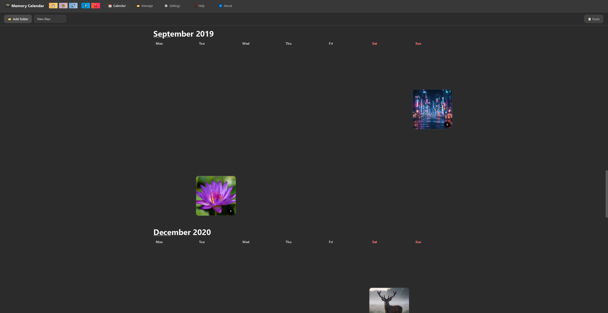
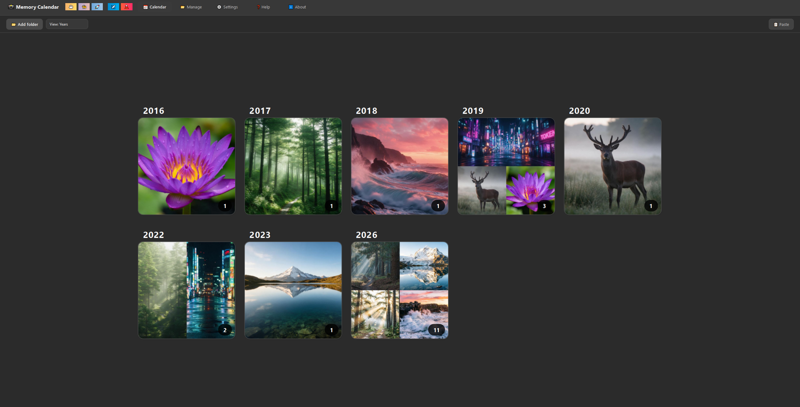
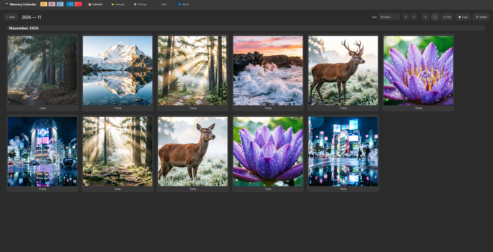
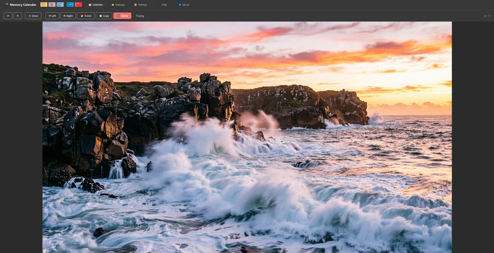
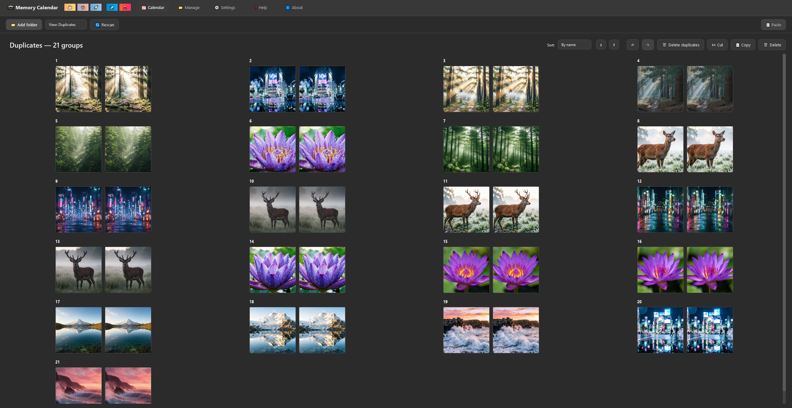
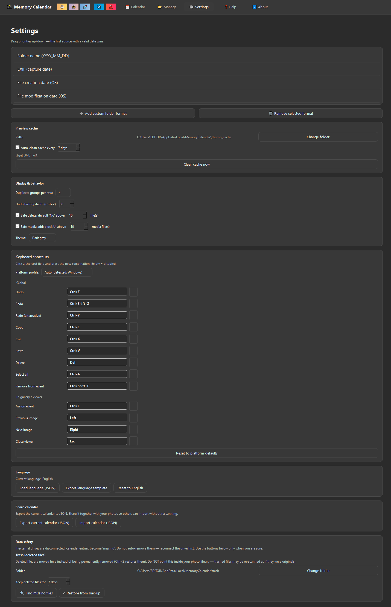
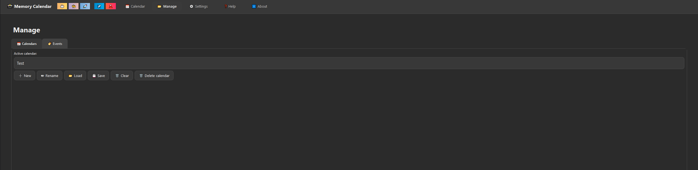

# 📸 Memory Calendar

A single-file desktop photo/calendar manager for Windows, Linux and macOS.
Arranges local photo and video libraries into calendar views by capture
date — Days, Months, Years, Events, Duplicates.

Built with **PySide6** (Qt 6), **Pillow** and **OpenCV**. Distributed as
one `Memory_Calendar.py` file — no installer, no service, no cloud,
no telemetry.

> [**⬇️ Download latest release**](https://github.com/TinoMakesDev/memory-calendar/releases)

> Status: **v1.0 release (Windows) / v1.0 BETA (macOS, Linux)**
> See [Platform Support](#platform-support) and [Status](#status) for details.

---

## Features

- 📅 **Five view modes** — Days, Months, Years, Events, Duplicates
- 🖼 **Gallery + fullscreen viewer** with rotate, delete (to trash),
  and prev/next navigation
- ⬇️ **Drag & drop** from file manager; **cut / copy / paste** inside the app
- 🗂 **Events** (categories) as global virtual albums across the whole library
  (they are independent of the currently active calendar)
- 🔍 **Duplicate detection** — full SHA-256 for videos, sampled for large
  photos (3 × 2 MB — false positives astronomically unlikely)
- ↩️ **Undo / redo** with trash-backed recovery, configurable history depth
- 🌍 **Localization** — loadable JSON language files; template export
- ⌨️ **Customizable Hotkeys** — rebind almost any action (with conflict detection and platform profiles)
- 🎨 **Themes** — Light and Dark Gray
- 🗄 **Safe file operations** — every delete goes to app-managed trash
  first; atomic JSON writes; automatic backups when file count drops
  sharply; configurable trash folder and retention (7–365 days,
  default 7). Auto-cleanup removes only Memory Calendar's own trash
  files (name pattern `<timestamp>_<filename>.<ext>`) — foreign
  files in the trash folder are left untouched
- 🛡 **Safe media add** — folder scans block destructive operations
  (delete / paste / undo / redo / clear-cal / import / …) until the
  merge finishes; large scans can open a modal progress dialog with
  Cancel (threshold configurable in Settings, default 50 files)
- 🧩 **Runs from a single `.py`** — no build step required

---

## Platform Support

| OS | Status | Notes |
|---|---|---|
| **Windows 10/11** | ✅ **Stable** | Primary target. Exhaustively tested by the maintainer. |
| **macOS 12+** | ⚠️ **BETA** | Code compiles and is ported, but **not tested on real hardware**. |
| **Linux** (Ubuntu 22.04+) | ⚠️ **BETA** | Code compiles and is ported, but **not tested on real hardware**. |

**Important Note for macOS/Linux Users:**
While the application architecture is fully cross-platform (Qt 6, Pillow, OpenCV), the maintainer does not have access to macOS or Linux environments to perform end-to-end testing. The code includes platform-specific guards (e.g., hiding unsupported file creation dates on Linux, using `dbus` for file manager integration, mapping `Ctrl` to `Cmd` and `Del` to `Backspace`), but edge cases may remain.
Please treat macOS and Linux builds as BETA. If you encounter issues, please submit a bug report with your OS version and `logs/app.log`.

---

## Safety model (read this before trusting it with a library)

- **Nothing is deleted from disk immediately.** Delete → trash folder
  (default `DATA_DIR/trash/`, configurable in Settings), auto-cleaned
  after a configurable retention period (7–365 days, default 7).
  Ctrl+Z restores. **Auto-cleanup is prefix-scoped:** only files
  matching the `mc_<timestamp>_<filename>.<ext>` pattern (created by
  Memory Calendar itself) are ever removed by retention. Any other
  file in the trash folder is user-owned and left alone. This makes
  it safe to point trash at a folder with existing data if needed,
  though a dedicated empty folder is still recommended.
- **Undo snapshot** is taken before every destructive operation (delete,
  paste, dedup, event assignment). Configurable depth (1–200, default 30).
- **State JSON is written atomically** (`tempfile` + `os.replace`) and
  backed up automatically when the file count drops by > 5% or to zero.
- **Cut + paste done outside the app** (via Explorer / Finder) cannot be
  undone inside the app — see `KNOWN_LIMITATIONS.txt` A1.
- **Do not point it at a folder you don't have a separate backup of.**
  The app is a gallery, not a backup tool.

See `KNOWN_LIMITATIONS.txt` for the full honest list of behaviours that
look like bugs but are by design.

---

## Requirements

- **Python ≥ 3.9**
- **PySide6 ≥ 6.0**
- **Pillow ≥ 9.1** (≥ 9.2 strongly recommended — older versions can drop
  EXIF sub-IFD on rotate; 9.1 added `Image.Resampling` which thumbnails
  depend on)
- **opencv-python ≥ 4.5**
- *(optional)* **pillow-heif** — enables HEIC/HEIF preview, rotate,
  and thumbnail support. Without it, HEIC files are visible in the
  gallery but cannot be rotated (the app refuses, never corrupts).

Tested on Windows 10 x64 (Python 3.11, PySide6 6.5). macOS and Linux
are **BETA** (see Platform Support table above).

---

## Install

~~~bash
py -m pip install PySide6 Pillow opencv-python
# optional, for HEIC support:
py -m pip install pillow-heif
~~~

## Run

~~~bash
py Memory_Calendar.py
~~~

### Build a standalone executable (optional)

~~~bash
py -m pip install pyinstaller
py -m PyInstaller --windowed --name "MemoryCalendar" Memory_Calendar.py
~~~

`--windowed` (a.k.a. `--noconsole`) is fine — the app handles
`sys.stderr is None` explicitly (Qt / OpenCV warnings from video
decoding are suppressed through a refcounted fd guard).

---

## Where your data lives

| OS | Path |
|---|---|
| Windows | `%LOCALAPPDATA%\MemoryCalendar\` |
| macOS   | `~/Library/Application Support/MemoryCalendar/` |
| Linux   | `$XDG_DATA_HOME/MemoryCalendar/` (default `~/.local/share/...`) |

Inside:

~~~
config.json               — settings
calendar_data.json        — calendars, categories, duplicates
calendar_backups/         — rolling state backups (keep = 20)
trash/                    — deleted files, auto-cleaned after 7–365 days
                            (configurable in Settings; folder can be
                            changed). Only prefix-matched files
                            (^mc_<ts>_) are removed by retention —
                            foreign files in this folder are left alone
thumb_cache/              — generated thumbnails
logs/app.log              — rotating log (2 MB × 4)
~~~

Back up that directory to snapshot your calendar state. Your **photos**
themselves are never moved or modified except by your own actions in
the app (rotate writes in place via temp+replace; HEIC without
pillow-heif is refused, not corrupted).

---

## Documentation

- **[KNOWN_LIMITATIONS.txt](KNOWN_LIMITATIONS.txt)** — behaviours that
  look like bugs but are intentional, cosmetic, or accepted trade-offs.
  ~40 entries with rationale. Read this before filing an issue.

**Project policy:** patches are accepted only when they prevent data
loss, file corruption, or an application crash. 

---

## Status

| | |
|---|---|
| Code state | v1.0 (Windows stable, macOS/Linux BETA) |
| Tested OS | Windows (Stable), macOS/Linux (BETA) |
| Data-loss bugs open | **0** |
| Data-loss-adjacent bugs open | **0** |
| UX-critical bugs open | **0** |
| Cosmetic / hardening | 0 critical; minor issues tracked internally |

---

## Screenshots

### Calendar views
| Days | Years |
|---|---|
|  |  |

### Gallery & Viewer
| Gallery | Viewer |
|---|---|
|  |  |

### Duplicates & Settings
| Duplicates | Settings & Hotkeys |
|---|---|
|  |  |

### Manage
| Manage |
|---|---|
|  |

---

## Contributing

1. **Before you file a bug**, grep both `KNOWN_LIMITATIONS.txt` for your scenario. Most likely it's already
   tracked.
2. Bug reports should include:
   - OS + Python + PySide6 + Pillow versions
   - repro steps
   - `logs/app.log` excerpt
   - whether files were lost / corrupted / the app crashed
3. Pull requests: **one fix, one topic**. Cosmetic changes are welcome
   only if they don't touch working code paths. Data-safety changes
   require a repro of the underlying defect first.
4. If you're proposing a **new** limitation rather than a bug, add it to
   `KNOWN_LIMITATIONS.txt`. Never patch behaviour silently — every change to
   safety-relevant code must have a rationale in one of those files.

---

## License

This project is licensed under the **Business Source License 1.1 (BSL 1.1)**.

**What this means in plain English:**

- ✅ **Source code is fully available.** You can read, fork, modify,
  and redistribute it.
- ✅ **Free for personal use** and for **organizations with 10 or fewer
  employees** (including affiliates and contractors) — no payment
  required, no registration.
- 💼 **Commercial license required** for organizations with **more than
  10 employees**.
- ⏳ **No automatic open-source conversion** is scheduled. This is a
  **source-available** project, not an OSI-approved open-source project.

BSL 1.1 is deliberately chosen over a pure open-source license: it keeps
the code readable, forkable, and modifiable for the community, while
ensuring that larger commercial users contribute back. Small teams and
individuals get the tool for free; larger organizations buy a license.

### Commercial license tiers

Priced **per company**, not per seat. Annual subscription. One
subscription covers **all current and future applications** published
by TinoMakesDev.

| Tier | Company size |
|---|---|
| **Free** | 10 or fewer employees |
| **Starter** | 11–30 employees |
| **Team** | 31–50 employees |
| **Business** | 51–100 employees |
| **Enterprise** | More than 100 employees (custom quote) |

**Current pricing and purchase:** see the subscription page on
[lava.top](https://app.lava.top/tinomakesdev?tabId=subscriptions).
Prices may change for new subscribers over time; existing subscriptions
keep the price they were purchased at for the duration of that
subscription year.

### How to verify a commercial license

A valid commercial license is established by **both** of the following:

1. An **active annual subscription** purchased through lava.top, and
2. A **payment receipt / invoice** issued by lava.top.

The lava.top invoice is the primary financial document for accounting
and tax purposes. Each subscription year also unlocks a **license code
document** in the subscribers-only section of the lava.top page — a
supplementary confirmation document for internal reporting and audits.

### Supporting the project

The application includes optional donation buttons (Buy Me a Coffee,
Feed My Cat, Support the Author). These are entirely optional — the
application is fully functional without them. Donations do **not** grant
a commercial license; they are a voluntary thank-you.

### Full license text

See [`LICENSE`](LICENSE) for the complete BSL 1.1 text with parameters.

---

## Support

The app includes optional support buttons in the toolbar
(Buy Me a Coffee, Feed My Cat, Support the Author, Telegram, Lava.top).
These are **optional** — the app is fully functional without them.

- ☕ [Buy me a coffee](https://app.lava.top/products/c3372120-4da5-4016-9cf8-37872efcfd7d)
- 🐈 [Feed my cat](https://app.lava.top/products/ae4d67de-490a-4c41-a52e-971f431a0ead)
- 🚀 [Support the author](https://app.lava.top/products/a9db29ed-7abf-46cb-a69d-0239b6b16aa5)
- ✈️ [Telegram](https://t.me/+lgzAbsvkPi9lYjIy)
- 🌋 [Lava.top](https://app.lava.top/tinomakesdev?tabId=subscriptions)

---

## Acknowledgements

- Qt for Python (PySide6) — the GUI framework
- Pillow — image I/O and EXIF handling
- OpenCV — video frame extraction
- pillow-heif — HEIC support (optional)